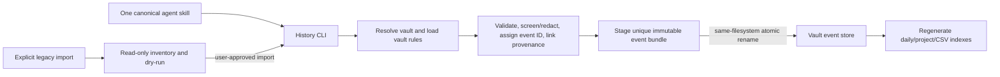

# Unified Obsidian Work History — Approved Design and QA

**Status:** Approved design; implementation, 80-test suite, five paired synthetic evaluations, public release, and installed-skill cutover verified. Legacy GitHub repository retirement remains incomplete until deletion is confirmed on GitHub.
**Scope decision:** Combine only the `history-skills` and `obsidian-project-history` skill projects. Do not integrate TraceForge, Work Blackbox, LatticeMind, or other repositories.
**Repository/skill name:** `obsidian-work-history`.

## 1. Goal

Deliver one portable agent skill and one public repository for preserving project work history in an Obsidian vault. Retain `history-skills`' evidenced work-recording, provenance, versioned-artifact and test capabilities; add `obsidian-project-history`'s vault resolution, project/year/date organization, backlinks, interruption/resume semantics, evidence labeling, and partial-failure rules.

The Vault is the canonical location for new history. History is an auditable record, not proof of QA, approval, or acceptance. The skill MUST distinguish observed, user-reported, inferred, intended, and verified claims.

## 2. Sources and boundaries

| Source | Reuse | Exclude |
|---|---|---|
| `history-skills` | Existing `SKILL.md`, `scripts/history.py`, `references/record-format.md`, tests, versioned artifact/provenance concepts, index generation | Its `~/.history/` default as the destination for new records |
| `obsidian-project-history` | Vault resolution, dated project notes, link-destination deduplication, legacy read-only continuity, evidence honesty, failure behavior, evaluation cases | A second independently installed skill or a second writer workflow |
| TraceForge, Work Blackbox, LatticeMind, other repos | Nothing in this release | Code, collectors, daemons, shared runtime, integrations |

This is a skill and local CLI/tooling consolidation, not a background monitoring product. No repository's project data or private Obsidian vault content is copied into the public source repository.

## 3. User scenarios

1. **Record project work:** An agent records the accessible user request, relevant execution prompts/results, decisions, failures, verification, and produced artifacts in the resolved Obsidian vault.
2. **Continue an interrupted operation:** The agent reads only relevant prior evidence, preserves the interrupted state, and records the resumed transition without inventing a start or completion.
3. **Resume legacy history:** The user explicitly requests migration or continuity from `~/.history` or project-local `.history`; the tool inspects read-only first and imports only after a dry-run is reviewed.
4. **Find a project's progress:** The user navigates project index → year → date notes and follows links to the daily note and recorded artifacts.

## 4. Storage model

Canonical readable notes:

```text
<Vault>/Work History/
  <Project Slug>/
    README.md                              # project identity and navigation
    <YYYY>/
      README.md                            # optional year navigation
      <YYYY-MM-DD>.md                      # one generated daily index per project/day
      Events/
        <YYYY-MM-DD>/<event_id>/
          record.md                        # immutable event metadata and readable record
          original.md                      # exact screened source text when permitted
          records.csv
          links.csv
          artifacts/                       # copied binary/text snapshots
  _index/projects.md                       # generated global navigation
  _index/events.csv                        # generated cross-project query index
```

Each event bundle is the canonical immutable source record, created in a unique directory. The dated Markdown note is a generated navigation/view file that links to event bundles; it is not the sole audit source and must not silently overwrite manual content. Project slugs must be safe, stable, and collision-resistant, with the original project identity kept in metadata. Each event needs a stable unique ID, timestamp/timezone, project identity, event kind/status, source/provenance, parent event IDs, and artifact references. Preserve the existing CSV fields (`record_id`, `event_id`, `recorded_at`, `title`, `kind`, `status`, `tool`, `model`, `version`, `role`, `source_path`, `snapshot_path`, `sha256`) and links (`precedes`, `used`, `produced`) or document a lossless versioned mapping before migration. Preserve unknown source fields; never silently discard them.
Slug rule: reuse the `project.json` mapping already recorded in the Vault. For compatibility with the prior Obsidian skill, adopt an unmarked exact-display-name folder only when its first non-empty README heading is exactly `# <Project> — Work History`; persist the mapping on the first successful record and preserve its existing notes. Otherwise, new projects use Unicode NFKC normalization, safe path replacement, a bounded readable portion, and a fixed-length SHA-256 suffix of the canonical identity. Keep the original identity and slug together in `_index/projects.csv`; never silently remap an existing project when its display name changes.

The current upstream CLI status values are `received`, `started`, `completed`, `failed`, and `interrupted`; it has no `resumed` status. Represent a resume as a new event whose kind/transition identifies `resume`, with status `started`, `completed`, or `failed`; link it to the prior interrupted event. Do not silently extend/rename status values without a schema migration.
New writes intentionally change the old CLI's default destination from `Path.home() / ".history"` to the resolved Obsidian vault; preserve the old CLI behavior only for explicit legacy import, not as a hidden fallback. Keep the upstream Python 3.10+ standard-library constraint unless implementation evidence requires changing it. Event `recorded_at` remains UTC; the dated Vault path uses the configured/documented vault-local timezone and records both the UTC instant and derived local date/timezone. If the vault timezone is unknown, do not guess across a date boundary; require an explicit timezone or use a clearly labeled UTC date.
## 5. Workflow and architecture



The single skill is the only agent-facing workflow. The CLI owns deterministic mechanics (validation, ID assignment, artifact hashing/copying, index generation, and import); the skill owns conversation-aware evidence selection and truthful reporting. Preserve the upstream publish invariant: prepare a complete event in a same-filesystem staging directory, then atomically rename it into a unique destination. Indexes are derived and may be regenerated from published event bundles.

Concurrent event writers MUST NOT append directly to one shared daily Markdown note. Daily indexes are generated under a per-project/day lock and written to a temporary file before atomic replacement. Managed blocks use exact markers `<!-- obsidian-work-history:managed:start -->` and `<!-- obsidian-work-history:managed:end -->`; on a legacy unmanaged daily note, preserve all existing content and append only one bounded managed block after re-reading. Compare the file hash immediately before replacement. If markers are malformed, the file changed, or merge boundaries are ambiguous, keep the immutable event bundle and stop index publication rather than overwrite user content. Atomic replacement protects file integrity but does not serialize non-cooperating external editors; the CLI MUST report this limitation. All writes MUST remain under the resolved vault; reject traversal and resolved symlink/junction escapes. Deduplicate wikilinks by exact destination. On partial failure, report exactly which event bundles/indexes succeeded and re-read outputs before claiming completion.
## 6. Vault resolution and privacy

Resolution order: explicit request path; `OBSIDIAN_VAULT_PATH`; documented workspace/Obsidian configuration; then a documented default only after verifying it exists. If unresolved, stop before writing; do not fall back to `~/.history`, the project directory, or a guessed path.

The upstream CLI currently requires callers to screen secrets before recording and does not detect/redact them. The consolidated design must define this boundary precisely: the skill screens visible text and redacts recognizable values for common credential forms (provider/API tokens, GitHub tokens, AWS keys, bearer/JWT tokens, database URLs, and private-key blocks) before calling the CLI; the CLI applies deterministic checks to supported text files and refuses to claim exhaustive scanning. On ambiguous matches, fail closed for that record and ask for review rather than silently retain or destroy the value. Binary snapshots require explicit permission and either an approved local scanner or exclusion; no binary scanning guarantee is implied. Record only that redaction occurred, never the secret. Never store hidden reasoning or data from unapproved paths. No background watcher or automatic capture is included.
## 7. Legacy migration and cutover

- `~/.history/` and `.history/` are read-only inputs by default; never auto-move or delete them.
- Treat the two legacy shapes differently: `~/.history` is the versioned event-bundle source for explicit import; project-local `.history/` is read-only continuity evidence for only the resumed operation, with source-path attribution. Do not feed arbitrary project `.history/` folders to the bundle importer or bulk-import them by default. Any requested bulk import of that format requires a separate format adapter and dry-run mapping.
- Inspect legacy `events/` bundles, both per-event CSVs, original Markdown, artifact bytes, parent links, hashes, index snapshots, and text for known secret patterns. Dry-run reports event/artifact counts, destination mapping, collisions, unsupported fields, secret flags without exposing values, incomplete event folders, and `.pending-*` staging folders separately. Pending folders are never treated as published events.
- Import published event bundles idempotently using source root + relative event path + source event ID. Preserve original IDs, links, and source hashes. Copy text only after the same secret screening/redaction as new records; store sanitized bytes and their hash, retain the original hash as provenance, and never copy the secret-bearing original bytes. Ambiguous findings block that event for user review. Copy binary snapshots only after an approved local scanner reports clean; otherwise exclude them, name the exclusion, and do not claim a complete migration. Any unknown source field MUST be retained in versioned migration metadata or that event's import MUST fail; reporting a dropped field is not successful migration. Regenerate derived Vault indexes rather than importing old index snapshots as canonical records.
- `inspect`/dry-run and `import` are separate. A user explicitly approves the preview before destination writes. Source roots remain unchanged.
- Before the new skill is installed, tested, and published, do not remove or alter the two old GitHub repositories.
- Before deleting either public repository, create a complete private mirror/bundle of all branches/tags and a manifest of owner/name/URL/commit SHAs; checksum the backup and prove it can be cloned/restored. The backup MUST remain outside the new public repository and outside the Vault. Then install/smoke-test the unified skill, remove old skill installations, verify all source assets/tests/design/evals in the new repo, and delete only the exact two user-authorized repositories. Read back the deletion state; preserve the verified private backup and release record.


## 8. Repository contents

The new repository contains one `SKILL.md`, the migrated CLI and versioned record-format reference, Obsidian layout guidance/templates, deterministic tests, evaluation prompts/fixtures, README, and this design document. Both source repositories currently have no GitHub-detected license metadata. Before copying content, verify authorship/provenance and record the licensing decision; do not assume that public visibility grants reuse rights or silently add MIT. If no license is explicitly approved, ship no LICENSE file. Do not keep a second skill name, compatibility alias, duplicate writer, or unrelated collectors. The old repository names are migration inputs, not permanent packages.

## 9. Acceptance criteria

1. Exactly one active skill manifest/name is shipped; its trigger covers AI work evidence/provenance and Obsidian project/date logging.
2. A user can record and find a work event under the stated Vault tree; project and daily links have no duplicate destinations. A deterministic boundary test uses an event near midnight UTC whose configured Vault-local date differs; the event bundle and daily index use the Vault-local date and preserve the UTC instant.
3. Event bundles are immutable after publication; same-day indexes are regenerated without losing unmanaged content. Concurrent writers either both publish unique bundles or one stops safely; no lost event.
4. Existing same-day prose/frontmatter is preserved; rerunning the same imported event does not duplicate it.
5. Every listed output is verified or explicitly labeled user-reported/intended; completion requires observed evidence.
6. Missing Vault resolution causes zero writes; traversal/symlink escape is refused. Secret-pattern text tests demonstrate redaction/refusal, and binary tests demonstrate required consent or exclusion without claiming full scanning.
7. Artifact snapshots preserve bytes/hash/version/source when permitted. Every unsupported legacy field is retained or causes that event's import to fail; report-only dropping cannot count as a successful import.
8. Legacy inspection is read-only; dry-run/import are separate; import preserves IDs, link relations, and clean-source bytes/hashes, is idempotent, and identifies pending/corrupt inputs without publishing them. Secret-bearing legacy text is redacted or refused before copy; unscanned binary data is excluded, with incomplete imports reported as incomplete.
9. A simulated partial event/index write failure leaves truthful, recoverable status and never claims full success.
10. Tests cover prior history CLI behavior and new Obsidian, schema migration, deduplication, privacy, concurrency, and failure scenarios; smoke test exercises the actual CLI path.
11. New public repository URL, visibility, default branch, pushed commit, and clean intended file set are verified before retiring old skills.
12. Both old repositories are backed up and restore-verified before deletion; exact owner/name targets and GitHub deletion results are verified.
13. Source authorship and license are checked; the new repository includes a LICENSE only if the user approves the selected terms.
14. No TraceForge, Work Blackbox, LatticeMind, or private vault data is included.

## 10. Risks and mitigations

| Risk | Mitigation |
|---|---|
| Existing `~/.history` schema loses information | Inspect full format and CLI before migration; preserve unknown fields/source files; dry-run and count/hash comparison |
| Duplicate records from retry or two active skills | One canonical skill; stable event IDs; remove old registrations only after new installation passes |
| Secret or private content enters public GitHub | Vault/evaluation data excluded; fixtures synthetic; secret scan and staged-file allowlist before push |
| Vault is unavailable or contains conflicting rules | Fail closed; report checked paths; do not invent a destination or overwrite notes |
| Vault size grows from binary copies | Define artifact size/type policy before implementation; record link/hash only when copying is unsafe or not permitted, and label it clearly |
| Deleting old repos breaks URLs/history | Migrate and verify first; retain archival clone/commit references; final owner/name confirmation and API readback before/after deletion |

## 11. Release sequence

1. Review/approve this design and inspect the complete upstream CLI format/tests.
2. Implement the consolidated skill and CLI in a fresh repository; update README/evals.
3. Run upstream regression tests, new permanent tests, all five existing Obsidian scenarios, migration dry-run/import scenarios, and a CLI smoke test.
4. Independent review; stage only the new repository's intended files; scan for private data/secrets.
5. Create the new public repository, push, and verify URL/visibility/default branch/commit.
6. Install and smoke-test the new skill; only then remove old skill registrations and perform the separately confirmed old-repository deletion. Verify deletion by querying GitHub and record exact outcomes.

**Approval gate:** The user approved this design and authorized implementation, creation/publication of the new public repository, removal of the two old skill registrations, and deletion of the two named old public repositories. Deletion remains irreversible and is gated by verified private all-ref backups, tested restoration, successful public release and cutover, and exact final owner/repository checks.
## 12. Design QA record

QA compared this proposal with the actual `history-skills` CLI, `record-format.md`, tests, and the `obsidian-project-history` skill.

| Finding | Resolution |
|---|---|
| The upstream writer publishes unique immutable event bundles, while a single daily note is mutable and unsafe for concurrent append. | Event bundles are now the canonical source; daily notes are derived indexes. Atomic staging/rename, per-day index locking, managed markers, and conflict stop behavior are specified. |
| Resume was described as a lifecycle state, but the existing CLI status enum does not include `resumed`. | Resume is a new linked event with `kind/transition=resume` and a valid status; status schema is not silently changed. |
| Migration criteria did not map actual CSV fields, artifact hashes, link relations, or interrupted staging folders. | The design requires lossless field/link preservation, source-based idempotency, byte/hash checks, derived index regeneration, and explicit `.pending-*` reporting. |
| Secret handling was stated as a guarantee despite the current CLI performing no scanning. | The design defines best-effort text screening/redaction, explicit binary limitations, fail-closed ambiguous cases, and disallows exhaustive-scan claims. |
| Project path collisions, UTC event time versus local daily date, and external note edits were underspecified. | The design specifies stable hashed slugs, both UTC and vault-local date/timezone, managed note markers, compare-before-replace, and conflict reporting. |
| Deleting public repositories without a recoverable backup or assuming a license would be unsafe. | Deletion requires private verified mirrors/bundles of all refs; GitHub reports no license metadata for either source, so license choice/authorship review is a release prerequisite. |
| Independent review: legacy import could copy credential-bearing source bytes even though new writes redact. | Dry-run scans legacy text without exposing values; secret-bearing originals are never copied. Text is redacted or blocked; unscanned binaries are excluded, and incomplete imports are not reported complete. |
| Independent review: acceptance allowed an unsupported field to be dropped after merely reporting it. | Every field must be retained or the event import fails; explicit report-only loss cannot pass. |
| Independent review: Vault-local date logic lacked a UTC-midnight boundary test. | Acceptance now requires a deterministic case where UTC and Vault-local dates differ, checking both index location and preserved UTC instant. |
| QA: project-local `.history/` may not use the global event-bundle CSV layout. | The design separates global event-store import from project-local continuity reads; unsupported local formats are not bulk-imported without a distinct adapter and approved dry run. |
| QA/evaluation: the old skill's human-named project folder was not recognized by the event CLI, so a new hashed folder could strand existing daily notes. | Reuse only an unambiguous exact-name legacy folder with the expected README heading, then persist `project.json`; otherwise preserve it and avoid silent remapping. A permanent CLI→indexer regression checks this compatibility and exact-target link deduplication. |
| Review of migration code found Python 3.10+ Windows junction fallback and late source-CSV digest rereads. | Detect Windows reparse points through `lstat` when `Path.is_junction` is unavailable; hash the exact CSV bytes parsed during analysis. Added RED→GREEN tests and independent re-review. |
| Final CLI smoke found that verbose snapshot paths exceed the Windows path limit in deep Vault locations. | Store query snapshots in a compact date/ID directory with fixed `records.csv`/`links.csv` names; add a deep-path regression and keep the returned files below the legacy Windows path limit. |
| Independent security review found the CSV snapshot writer could follow a symlink/junction at `Work History/_index/snapshots` outside the Vault. | Check every existing vault path component with the shared symlink/junction guard before creating the snapshots directory; a regression test proves rejection and zero outside writes. |

The reviewed source CLI is Python 3.10+ standard-library code; current GitHub license metadata for both source repositories is `null`. No `LICENSE` is included without explicit approval. Publication requires GitHub readback of URL, visibility, default branch, and commit; old-repository deletion requires private all-ref backups and restore verification.

## Implementation addendum (schema_version 1)

- **Excluded artifacts are graph-linked provenance records.** An artifact that is binary or not supported UTF-8 text is never copied. It still receives an opaque `record_id`, a `records.csv` row with blank `snapshot_path`/`sha256` (explicitly claiming no stored bytes), and a `links.csv` edge (`used` for input/document, `produced` for output). `event.json.excluded_artifacts[]` carries `record_id`, `role`, `source_path`, the source `sha256` (provenance only — never the stored-snapshot hash), and `reason`.
- **Text screening.** `--text-file` and text artifacts pass deterministic redaction of known secret forms before staging; ambiguous matches fail the record closed. Stored bytes are sanitized UTF-8; `records.csv` `sha256` is the stored-bytes digest and `event.json` keeps `source_sha256`/`artifacts[].source_sha256` plus a `redactions` count.
- **CLI note.** `--utc-offset` must be passed with `=` syntax (`--utc-offset=-04:00`) because argparse otherwise reads a leading `-` as a new option.

## 13. Release verification

- Public repository: `https://github.com/DeclanJeon/obsidian-work-history`; visibility `PUBLIC`; default branch `main`; first published commit `200213d0814e66345ea168eed22a57beb5a997f0`.
- A fresh clone of that commit passed all 80 tests. `migrate.py inspect` classified the synthetic project-local `.history` fixture as read-only continuity evidence.
- The installed `obsidian-work-history` skill files were byte-identical to the public commit. An isolated installed-skill smoke published one synthetic event and refreshed both CSV and Obsidian indexes.
- Both old public repositories have private all-ref mirrors and complete-history bundles; bundle verification and restore-clone ref comparison passed.
- **Not complete:** GitHub readback still showed both legacy repositories public on their backed-up `main` commits. The first delete request was rejected for missing authorization; no deletion is claimed. Delete only the two approved targets after authorization, then read back both absence states.
